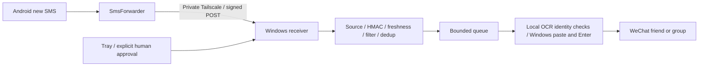

# SMS → WeChat Bridge

[中文](README.md) · [Security](SECURITY.md) · [Third-party notices](THIRD_PARTY_NOTICES.md)

Forward new Android SMS messages to a configured WeChat friend or group through a private Tailscale network and a Windows desktop. Local PaddleOCR checks search results and the conversation title; Windows UI automation pastes the original SMS and presses Send. A tray application controls forwarding, recipients, keyword filters, status and optional login startup.

This is personal desktop automation, not an official WeChat API. Only process messages you are authorized to receive and share, with recipient consent. Forwarding and login startup are disabled by default.



## Features and limitations

- Authenticated `POST /sms`, exact phone source IP restriction, optional SMS sender allowlist, timestamp validation and durable deduplication.
- Literal **contains**, **does not contain**, or **unrestricted** keyword filtering; forwards the complete original SMS, without a numeric OTP length restriction.
- The first search result must exactly match the configured friend/group. Visible duplicate names, friend/group collisions and collapsed results stop selection. The title is checked again after opening the chat; there is no fallback to the current conversation.
- Private temporary clipboard, empty-draft guard, bounded queue, expiry checks and persistent uncertain-send reservations. Unknown outcomes are never automatically replayed.
- Tray on/off/fault states, single instance, Job-owned subprocesses and optional interactive-user login startup.
- A successful result means the Send action was issued in the verified conversation. Full input text and outgoing bubbles are not automatically verified; success is not an independent delivery receipt.

The original deployment was tested with **Windows 11 Pro build 26100**, **Python 3.12 x64**, **WeChat 4.1.15.13**, and **Android 16**. The publication copy has separate isolated validation; no live messages were sent during publication. See [release validation](docs/RELEASE_VALIDATION.md). Other versions are not claimed compatible. Version mismatch stops sending; the application never downgrades WeChat.

WeChat GUI automation requires a logged-in, interactive desktop. Locking, sleep, logoff, RDP changes, focus changes or WeChat updates can stop it. Names containing whitespace are currently unsupported. Give every configured target a unique full remark/group name.

## Required software and official downloads

This repository distributes **Windows Python source code only**, not third-party installers. Install the following software using official sources:

| Device | Software | Official download | Purpose and compatibility |
|---|---|---|---|
| **Android SMS phone** | **SmsForwarder** | [GitHub Releases](https://github.com/pppscn/SmsForwarder/releases) | Required. Set up the SMS rule and Webhook; grant SMS, notification, autostart and background permissions. An earlier deployment worked on Android 16, while upstream's published compatibility scope primarily covers Android 4.4–13; verify your own device. |
| **Android SMS phone** | **Tailscale for Android** | [Download](https://tailscale.com/download/android) · [Guide](https://tailscale.com/docs/install/android) | Required. Connect to the same tailnet as Windows; allow the Android VPN and background connection. |
| **Windows PC** | **WeChat for Windows** | [Tencent PC download portal](https://pc.weixin.qq.com/) · [Microsoft Store](https://apps.microsoft.com/detail/xpfckbrnfzq62g) | Required. Stay signed in on an interactive desktop. **Only version 4.1.15.13 was live-tested**; newer official releases may not work, and the application does not downgrade WeChat. |
| **Windows PC** | **Python 3.12 (64-bit)** | [Official Python 3.12.10 Windows download](https://www.python.org/downloads/release/python-31210/) | Required. Install x64 and ensure `py -3.12` works. Dependencies were tested with Python 3.12, not automatically with 3.13/3.14. |
| **Windows PC** | **Tailscale for Windows** | [Download](https://tailscale.com/download/windows) · [Guide](https://tailscale.com/docs/install/windows) | Required. Join the same tailnet; restrict inbound Webhook access to the phone's Tailscale IP. |
| **Phone used to sign in to WeChat** | WeChat mobile app | [Official site](https://weixin.qq.com/) · [Google Play](https://play.google.com/store/apps/details?id=com.tencent.mm) | Needed if Windows login requires mobile QR/approval; it need not run on the Android phone receiving SMS. |

**Installed automatically by the commands below (no separate installers):** `pywin32`, `psutil`, `Pillow`, `numpy`, `PaddleOCR`, `PaddlePaddle`, `PaddleX` and their transitive dependencies. The separate `prepare_paddle_models.py` command obtains OCR weights from the [official PaddleOCR project](https://github.com/PaddlePaddle/PaddleOCR); no weights are bundled.

**Built into Windows:** PowerShell, Task Scheduler and Windows Defender Firewall. **Not required:** root access, ADB, permanent USB connection, Codex, VS Code or Git when using the source ZIP. For development, [Git for Windows](https://git-scm.com/downloads/win) and [VS Code](https://code.visualstudio.com/download) are optional.

If an official download is unavailable in your region, use a vendor-approved channel rather than an untrusted mirror.

## Install

Install official Python 3.12 x64, WeChat and Tailscale on Windows; install Tailscale and [SmsForwarder](https://github.com/pppscn/SmsForwarder) on Android. Log both devices into the same tailnet and approve phone permissions manually. No root is required.

In a fixed checkout directory, run PowerShell:

```powershell
py -3.12 -m venv .venv
py -3.12 -m venv .venv-wechat
.\.venv\Scripts\python.exe -m pip install -r requirements\receiver.txt
.\.venv-wechat\Scripts\python.exe -m pip install -r requirements\sender-lock.txt
.\.venv-wechat\Scripts\python.exe prepare_paddle_models.py
```

Models are intentionally not bundled. The last command explicitly downloads upstream Paddle models; review model licenses before use. Runtime inference is local and does not upload screenshots. Use an ASCII model path to avoid native-loader path limitations. See [setup details](docs/SETUP.md).

The default data directory is `%LOCALAPPDATA%\SmsWechatBridgeOSS`, separate from any previous deployment. An absolute `SMS_WECHAT_DATA_DIR` overrides it; `SMS_OCR_MODEL_DIR` overrides the local model directory. The same settings must be visible at login startup.

```powershell
.\initialize_config.ps1 -WindowsTailIP '<Windows Tailscale IPv4>' -PhoneTailIP '<phone Tailscale IPv4>'
```

This creates a current-user DPAPI secret and local `config.json`, preserving all three send-approval switches as off. Set exact sender numbers in local `SMS_ALLOWED_SENDERS`, including their actual country-code format, or explicitly choose `SMS_ALLOW_ALL_SENDERS="1"`. `config.example.json` contains no real addresses, numbers, recipients or secret.

## Android and WeChat configuration

Enable SmsForwarder's SMS broadcast forwarding. Grant new-SMS/notification/autostart/background permissions manually; do not enable historical-message queries or unrelated notification forwarding. Add a Webhook channel:

| Setting | Value |
|---|---|
| Method | POST |
| URL | `http://<Windows Tailscale IPv4>:<SMS_PORT>/sms` |
| Message template | `from=[from]&content=[org_content]&timestamp=[timestamp]&sign=[sign]` |
| Secret | Manually enter the locally displayed pairing secret |
| Proxy | None |
| Success keyword | Empty; inspect receiver state as well as HTTP status |

`show_pairing.ps1` displays pairing data in a local masked window, not the terminal or clipboard. Do not share its screenshot. Associate the SMS rule with this channel. Use exact numbers for a restricted rule, or explicitly opt into all senders. Keep a phone-only Windows firewall rule on the private Tailscale address; `configure_firewall.ps1` is an explicit administrator-only helper. Never expose a public webhook or forward the port from a router.

Start the tray:

```powershell
.\start_tray.ps1
```

Use **更改联系人** to set the unique full friend remark/group name and run navigation-only identity verification. Use **短信筛选设置** for filters, **开启转发** to explicitly approve sending, **关闭转发** to revoke and stop queued work, **查看运行状态** for redacted status, **开机启动设置** to opt into login startup, and **退出程序** to stop owned processes. Changing the target or filter disables forwarding and requires a new explicit enable action. Closing the launcher terminal does not stop the tray.

Login startup uses Task Scheduler with the current user, an interactive token and limited privileges, never Session 0. It is not registered by installation. The tray remembers the last explicitly selected switch state, but environment failures pause sending and expired messages are not replayed. Disabling cannot retract a Send action already submitted to WeChat.

| Mode | Keyword | Behavior |
|---|---|---|
| `contains` | 验证码 | Forward complete messages containing that literal text |
| `not_contains` | 广告 | Reject messages containing that literal text |
| `all` | ignored | All nonempty SMS messages may be forwarded |

Matching is case-sensitive, literal and space-sensitive, not a regex. Unrestricted mode may disclose unrelated SMS; choose deliberately.

## Tests and troubleshooting

```powershell
.\.venv\Scripts\python.exe -m unittest discover -s tests -v
.\.venv\Scripts\python.exe tests\native_acceptance.py
```

Tests use mocks, temporary databases and synthetic fixtures. Native integration uses real Windows processes, Job Objects and a temporary loopback listener, but mocks GUI sending. It does not send SMS/WeChat messages, access production secrets or change the real allowlist. GitHub Actions runs these secret-free checks on Windows.

Root modules preserve the validated flow: `bridge.py` handles authentication/queue/dedup, `wechat_sender.py` handles desktop actions, `tray_*` manages lifecycle, and `sms_filter.py` handles filtering. Tests, dependency manifests and deployment notes live in `tests/`, `requirements/`, and `docs/`.

- **No incoming request:** check SMS broadcast forwarding, rule/channel association, Android background permissions, Tailscale connectivity and firewall scope.
- **403:** inspect source IP, exact sender format, secret and phone clock; do not disable authentication.
- **200 ignored:** inspect the filter and `[org_content]` template; empty messages are ignored.
- **Unverified/ambiguous target:** verify again after a version/name change and use a unique name. Collapsed search results are conservatively rejected.
- **Desktop/focus error:** unlock the interactive desktop, log into WeChat and leave it in the foreground; manually clear your draft. The program never uses a different current chat as fallback.
- **Missing OCR models:** run the explicit preparation command; check the isolated data/model path.
- **Uncertain send:** no automatic retry; retain reservations and manually investigate. Use a fresh invalid test message for a separately approved acceptance run, without deleting dedup records.

## Security and license

Read [SECURITY.md](SECURITY.md) and [third-party notices](THIRD_PARTY_NOTICES.md). No personal configuration, credentials, SMS, chat screenshots, logs, databases, models, APKs or environments belong in this repository. Test addresses/numbers are synthetic fixtures.

Original project code is available under the [MIT License](LICENSE), with explicit rights-holder approval. Third-party dependencies and external applications retain their own licenses and terms. Public availability does not guarantee the absence of security risks. Review your own configuration, SMS source and target identity; repository ownership and Git commit metadata become visible when published.
