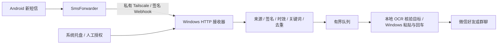

# SMS → WeChat Bridge

[English](README.en.md) · [安全说明](SECURITY.md) · [第三方许可](THIRD_PARTY_NOTICES.md)

在 Windows 上把 Android 新收到的短信，通过私有 Tailscale 网络转发到用户指定的微信好友或群聊。使用本地 PaddleOCR 核验微信搜索结果和会话标题，通过 Windows 界面完成发送。托盘提供手动开关、目标设置、关键词筛选、状态查看和可选登录启动。

这是需要交互式 Windows 桌面的个人自动化工具，不是微信官方接口。请仅处理自己有权接收和转发的短信，并取得收件人同意。短信全文可能包含账户信息；默认关闭转发和登录启动。



## 功能与边界

- SmsForwarder `POST /sms` 表单，时间戳 HMAC 验证，精确手机来源 IP 限制，可选发件号码白名单。
- 按“包含关键词”“不包含关键词”“不限关键词”筛选，转发原始短信全文；不限制验证码的数字格式。
- 微信好友和群聊搜索，第一结果精确匹配后回车，再核验会话标题。同名候选或折叠的更多结果会停止，需要设置唯一备注/群名后重新核验。
- 本地 OCR、临时私有剪贴板、空草稿检查、队列限流、时效检查、持久化去重和不明确发送结果保护。
- 托盘区分开启、关闭、故障；关闭会撤销发送许可并停止等待任务。单实例、Windows Job 管理子进程，异常恢复不重发不明确任务。
- 发送成功状态仅表示已在核验后的会话执行发送操作；不核验输入全文或发送气泡，也不表示对端独立收件确认。

## 已验证范围

原部署在 Windows 11 Pro（build 26100）、Python 3.12 x64、微信 **4.1.15.13**、Android 16 上完成过真实短信到微信的链路测试。发布副本进行了隔离自动化验证，未重新发送真实短信或微信消息。详见 [发布验证](docs/RELEASE_VALIDATION.md)。这不代表其他系统或微信版本兼容。

微信必须已登录且保持可交互桌面。Windows 锁屏、休眠、注销、RDP 会话变化、用户操作抢占焦点或微信更新都可能使发送停止。版本不匹配默认拒绝，不自动降级。当前目标名不支持空白字符。

## 安装

1. 安装官方 Python 3.12 x64、微信、Windows 和 Android Tailscale。两端加入同一 tailnet，手动完成登录和 VPN 授权。
2. 下载本项目源码，解压到固定目录。建议数据及模型目录使用 ASCII 路径，避免 Paddle 原生库的路径限制。
3. 在项目目录打开 PowerShell，执行：

```powershell
py -3.12 -m venv .venv
py -3.12 -m venv .venv-wechat
.\.venv\Scripts\python.exe -m pip install -r requirements\receiver.txt
.\.venv-wechat\Scripts\python.exe -m pip install -r requirements\sender-lock.txt
```

`sender-lock.txt` 是 Windows/Python 3.12 依赖快照，不含依赖源码或二进制。项目没有附带 OCR 模型；下列显式命令从 Paddle 官方来源准备本地权重，需自行审阅模型许可与下载网络访问：

```powershell
.\.venv-wechat\Scripts\python.exe prepare_paddle_models.py
```

应用运行时使用本地权重，不上传截图供云端识别。不要把模型、缓存或环境提交到仓库。有关配置、下载来源和故障处理见 [安装与配置](docs/SETUP.md)。

## 初始化和手机配置

发布版默认使用 `%LOCALAPPDATA%\SmsWechatBridgeOSS`，不会读取原有部署目录。可在启动任何脚本前设置绝对路径环境变量 `SMS_WECHAT_DATA_DIR`；模型可用 `SMS_OCR_MODEL_DIR` 指定。登录启动时也必须能解析到同一个目录。

```powershell
.\initialize_config.ps1 -WindowsTailIP '<Windows 的 Tailscale IPv4>' -PhoneTailIP '<手机的 Tailscale IPv4>'
```

初始化生成仅当前用户可解密的 DPAPI Secret 和本机 `config.json`，保留三个授权开关关闭。编辑本机配置中的 `SMS_ALLOWED_SENDERS`（精确号码，含收到的国家码），或明确选择 `SMS_ALLOW_ALL_SENDERS="1"`。示例文件中不包含任何地址、号码、联系人或密钥。

手机从 [SmsForwarder 官方项目](https://github.com/pppscn/SmsForwarder) 安装，手动授予接收短信、通知、自启动和不受限后台权限，不需要 Root。启用“转发短信广播”。创建 Webhook 通道：

| 项目 | 设置 |
|---|---|
| 方法 | POST |
| URL | `http://<Windows Tailscale IPv4>:<SMS_PORT>/sms` |
| 消息模板 | `from=[from]&content=[org_content]&timestamp=[timestamp]&sign=[sign]` |
| Secret | 本机配对窗口显示的值，不在聊天或终端粘贴 |
| 代理 | 无代理 |
| 成功响应关键词 | 留空，HTTP 200 表示请求处理完成；仍需查看非敏感状态 |

运行 `show_pairing.ps1` 可在本机隐藏式窗口查看配对信息；勿截图上传。配置短信转发规则并关联此通道。限制号码时用精确匹配；选择全部号码意味着所有符合关键词的短信都可能被转发。不要开启历史短信读取、通知转发或主动控制。

Windows 防火墙仅允许手机 Tailscale IP 到本机指定 Tailscale IP/端口，禁止公网监听、端口映射和公网 Webhook。`configure_firewall.ps1` 可显式创建受限规则，只有这一步需要管理员确认；日常托盘运行使用普通用户。

## 托盘使用

```powershell
.\start_tray.ps1
```

右击托盘“短信 → 微信自动转发”：

1. **更改联系人**：填写唯一完整好友备注或群名，选择好友、群聊或自动类型，先执行只打开会话的身份核验。不得以当前会话替代目标。
2. **短信筛选设置**：保存时关闭转发并撤销旧授权，需要重新手动开启。
3. **开启转发**：检查目标、微信版本、Tailscale 和桌面后，明确确认才写入本机生产授权。首次默认关闭。
4. **关闭转发**：撤销新发送许可并停止队列；已提交给微信的发送按键无法撤回。
5. **查看运行状态**：查看最近处理时间、结果和固定错误类型，不显示短信或验证码。
6. **开机启动设置**：用户可选择登录启动；注册当前用户、交互式、非管理员任务。默认不注册。记住上次明确设置的开关；环境故障时停止，过期短信不补发。
7. **退出程序**：关闭转发并结束托盘管理的子进程。关闭终端不影响已启动的托盘。

| 筛选模式 | 关键词 | 例子 |
|---|---|---|
| `contains` 包含 | 验证码 | “验证码：演示文字”匹配并转发全文 |
| `not_contains` 不包含 | 广告 | 含“广告”的短信不转发，其他非空短信可匹配 |
| `all` 不限 | 忽略 | 所有非空短信均可匹配，包括非验证码短信 |

按字面区分大小写，不做正则匹配；空格也是关键词的一部分。不建议在未评估隐私影响时使用不限模式。

## 测试与项目结构

```powershell
.\.venv\Scripts\python.exe -m unittest discover -s tests -v
.\.venv\Scripts\python.exe tests\native_acceptance.py
```

单元测试用 Mock、临时数据库和虚构测试数据；本地集成测试使用临时回环端口、真实 Windows Job 与进程，但 GUI 发送被 Mock，发送次数为零。CI 同样不连接真实手机或微信，不使用真实密钥。

根目录保留已验证模块及启动脚本，`bridge.py` 负责 HTTP/鉴权/队列/去重，`wechat_sender.py` 负责界面操作，`tray_*` 管理生命周期，`sms_filter.py` 负责筛选，`tests/` 存放隔离测试，`requirements/` 存放依赖清单，`docs/` 存放部署及发布说明。

## 常见问题

- **手机收到但电脑无请求**：核对短信广播总开关、规则通道、后台权限、两端 Tailscale 在线、IP 与防火墙。只用新建的无效测试短信，不读取历史短信。
- **403**：分别检查来源 IP、号码格式、Secret 与手机时钟；不要关闭鉴权排错。
- **200 ignored**：筛选未匹配或内容为空；确认使用 `[org_content]` 保留原始全文。
- **目标未核验/歧义**：微信版本或备注变化后需重新核验；同名好友和群聊须改为唯一名称。更多/折叠结果无法排除同名候选时也会停止。
- **窗口/桌面/焦点错误**：解锁当前交互式桌面，登录微信并保留前台，清理自己的草稿；不要自动向当前聊天兜底发送。
- **OCR 模型缺失**：运行显式模型准备命令，检查数据目录和 ASCII 模型路径。
- **发送结果不明确**：不会自动重试；保留持久化记录，人工确认后用一条新的无效测试消息验收，不删除去重库强行重发。

## 安全、许可与公开状态

参阅 [SECURITY.md](SECURITY.md)。此仓库不含个人配置、Secret、电话号码、tailnet 地址、聊天记录、截图、日志、数据库、模型、APK 或虚拟环境。测试号码与网络地址均为虚构夹具，禁止当成部署配置。

自有代码经权利人确认采用 [MIT License](LICENSE)。第三方依赖和外部应用继续遵循各自许可及服务条款。仓库保持 Private，公开前请完成项目审核。
